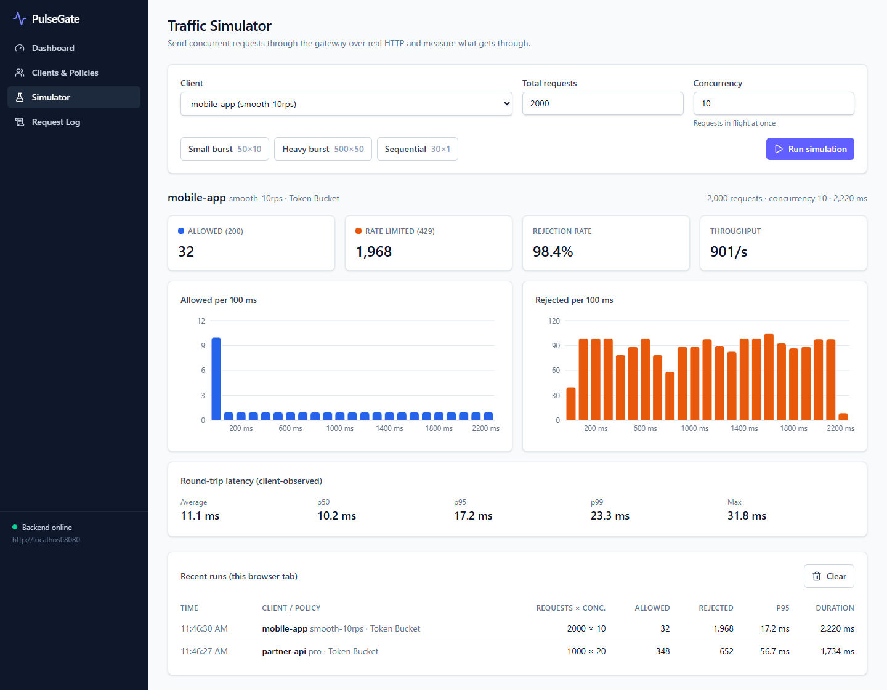
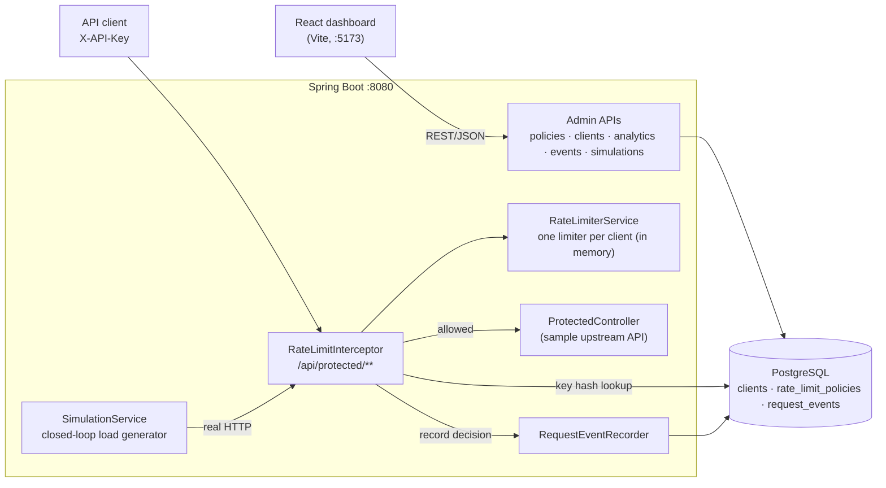
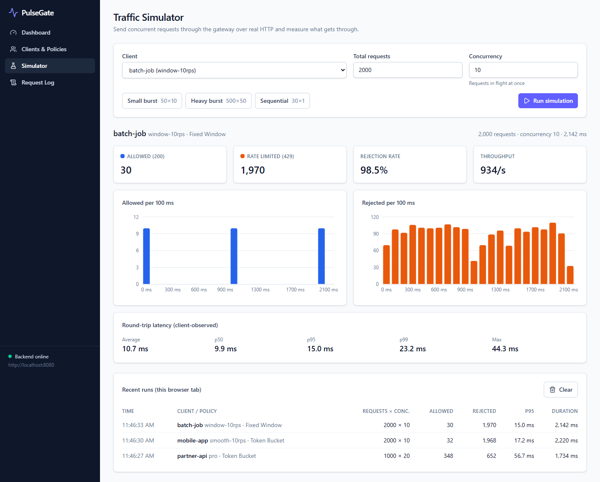
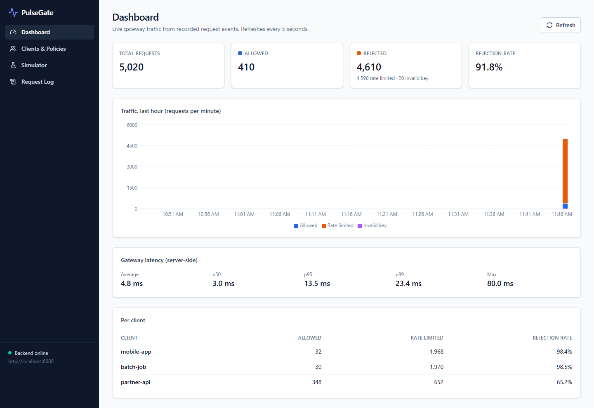
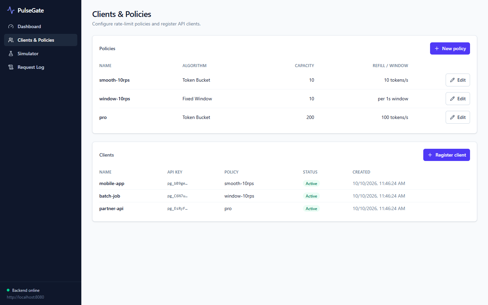
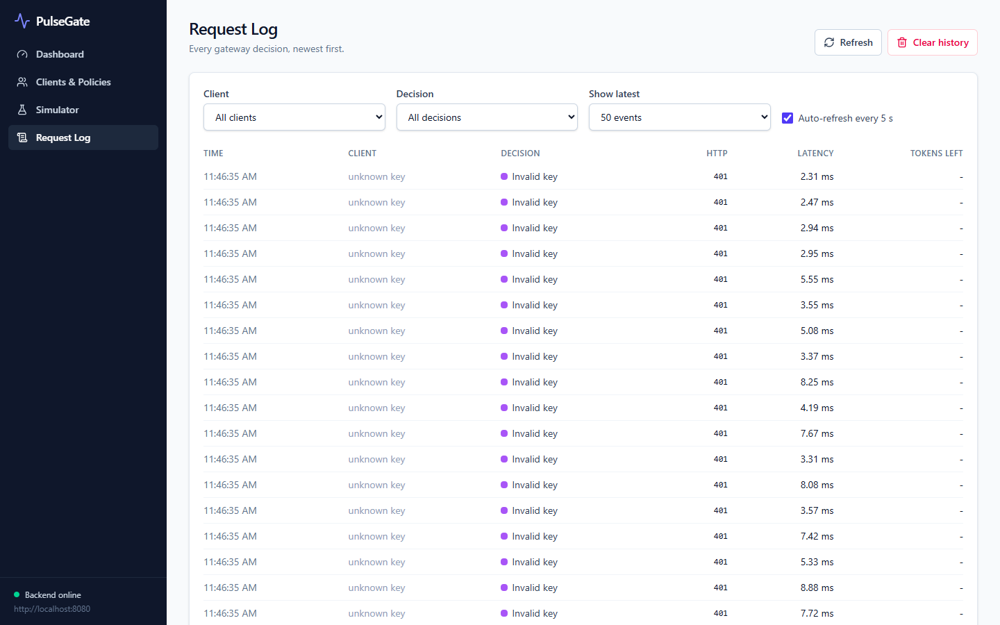

# PulseGate: API Traffic Gateway

PulseGate sits in front of an API, identifies each caller by API key, and enforces a per-client rate limit. Requests within quota reach the protected endpoint. Excess requests get **HTTP 429** with a `Retry-After` header. Every decision is recorded, and a React dashboard shows live traffic, latency and per-client rejection rates. A built-in simulator sends real concurrent HTTP traffic so you can compare **Token Bucket** and **Fixed Window** on the same workload.

**Stack:** Java 21 · Spring Boot 4 · PostgreSQL 16 · React 19 · Vite · Tailwind CSS · Recharts · JUnit 5 · Mockito · Swagger/OpenAPI



---

## What it does

| | |
|---|---|
| **Per-client policies** | Each client is assigned a policy: Token Bucket (burst capacity + refill rate) or Fixed Window (N requests per window). Editing a policy takes effect on the client's next request. |
| **HTTP 429 with useful headers** | `X-RateLimit-Limit`, `X-RateLimit-Remaining`, and `Retry-After` on rejection. Errors use RFC 9457 `ProblemDetail` JSON. |
| **API keys stored as hashes** | Keys are 192-bit random values, shown once at registration. Only the SHA-256 hash is stored, and raw keys are never logged. |
| **Request history** | Every decision (allowed / rate limited / invalid key) is stored with latency for analytics. |
| **Traffic simulator** | N concurrent workers send real HTTP requests through the gateway and report allowed/rejected counts, p50/p95/p99 latency, and outcome over time. |
| **Dashboard** | Totals, rejection rate, per-minute timeline, server-side latency percentiles, per-client breakdown, filterable request log. |

## Architecture



### Request flow (`GET /api/protected/resource`)

1. `RateLimitInterceptor.preHandle` hashes the `X-API-Key` header and looks up the client **with its policy in one query** (`@EntityGraph`).
2. Missing, unknown or inactive key → **401**, recorded as `REJECTED_INVALID_KEY`.
3. `RateLimiterService` gets (or atomically creates) the client's limiter and calls `tryConsume()`.
4. Out of quota → **429** + `Retry-After`, recorded as `REJECTED_RATE_LIMIT`. The controller never runs.
5. Allowed → the controller runs, the response carries the `X-RateLimit-*` headers, and `afterCompletion` records `ALLOWED` with end-to-end server latency.

### Key design decisions

**Token Bucket: O(1) time and memory per request.** Each bucket holds two fields, `tokens` (a double) and `lastRefillNanos`. There is no timer thread: each call adds `elapsed × rate` tokens (capped at capacity), then takes one if `tokens ≥ 1`. It uses `System.nanoTime()` (monotonic) rather than wall-clock time, so NTP adjustments can't create or destroy tokens.

**Concurrency: no token is ever spent twice.**
- `tryConsume()` is `synchronized`, so refill-then-take is one atomic step per bucket. A test fires 5,000 attempts from 50 threads at a 1,000-token bucket and asserts exactly 1,000 succeed.
- Limiters live in a `ConcurrentHashMap` and are created with `compute()`. Two simultaneous *first* requests for a client therefore can't each create a full bucket. Tested with 20 threads × 10 new clients.
- `tryConsume()` runs *outside* `compute()`, so the map's bucket lock is held only briefly and different clients never wait on each other.

**Failure behaviour: analytics never bypasses limits.** The limit decision is made in memory *before* anything is written. If the event insert fails (for example, the DB is down), `RequestEventRecorder` logs a warning and the response is unchanged. Losing an analytics row is acceptable; letting traffic through because the DB is slow is not. A unit test covers this.

**Policy changes without restarts.** The limiter stores the `LimitSpec` (algorithm, capacity, rate, window) it was built from. If the policy's spec differs on the next request, `compute()` swaps in a fresh limiter exactly once.

**Why SHA-256 and not bcrypt for API keys?** bcrypt is designed for low-entropy passwords. A 192-bit random key can't be brute-forced, so a fast deterministic hash is safe, and it allows an indexed `WHERE api_key_hash = ?` lookup. bcrypt's per-row salt would force comparing against every row.

**Clean layering.** The limiter package takes plain values (`LimitSpec`), not JPA entities, so it is unit-tested without Spring and could move to Redis without touching controllers.

## Measured results

All numbers below come from real runs on one machine. They are relative comparisons, not production benchmarks.

**Environment:** Windows 11 · Intel Core i5-12450H (12 logical cores) · Java 21.0.11 · PostgreSQL 16 in Docker Desktop · load generator running in the same JVM as the gateway.

### Token Bucket vs Fixed Window, same workload

Both policies average **10 req/s**: Token Bucket with capacity 10 and refill 10/s, Fixed Window with 10 per 1 s window. Workload: **2,000 requests, concurrency 10**, saturating both.

| Run | Algorithm | Duration | Allowed | Predicted |
|---|---|---|---|---|
| 1 | Token Bucket | 2,465 ms | 33 | 10 + 10 × 2.47 s = 34.6 |
| 1 | Fixed Window | 3,029 ms | 38 | 10 per window started |
| 2 | Token Bucket | 2,945 ms | 39 | 39.4 |
| 2 | Fixed Window | 2,973 ms | 30 | 3 windows × 10 |
| 3 | Token Bucket | 2,701 ms | 36 | 37.0 |
| 3 | Fixed Window | 2,738 ms | 30 | 3 windows × 10 |

The totals are similar. The **shape** is not. Allowed requests per 100 ms in one run:

```
Token Bucket : 10 1 1 1 1 1 1 1 1 1 1 1 1 1 1 1     (16 of 16 slices let traffic through)
Fixed Window : 10 0 0 0 0 0 0 0 0 0 10 0 0 0 0 0 0  (2 of 17 slices)
```

Token Bucket allows the burst, then smooths to the refill rate. Fixed Window releases the full quota at each window start and then blocks for the rest of the window. Fixed Window also allows up to **2× capacity across a window boundary** (capacity at 0.9 s + capacity at 1.1 s). `FixedWindowCounterTest.allowsTwiceCapacityAcrossAWindowBoundary` demonstrates this, and Token Bucket allows only 6 in the same scenario.

| Token Bucket | Fixed Window |
|---|---|
|  |  |

### Gateway latency

Server-side time per request across 5,020 recorded requests (the demo dataset): **p50 3.0 ms · p95 13.5 ms · p99 23.4 ms**. The in-memory limit check takes microseconds. Most of this time is the two database round trips per request (key lookup + event insert), and the load generator competes with the gateway for the same CPU. See *Limitations* for the planned fix.

### Test evidence

- **74 automated tests** (unit, MockMvc integration, and real-HTTP simulation tests). They run against a separate `pulsegate_test` database and never touch dev data.
- **Coverage (JaCoCo):** 95.8% of lines, 96.7% of branches. The report is written to `backend/target/site/jacoco/index.html` after `mvn test`.
- The limiter suites (Token Bucket, Fixed Window, per-client service), including their multi-threaded tests, passed **10 of 10 repeated runs**.

## Screenshots

| Dashboard | Clients & Policies |
|---|---|
|  |  |

| Request log |
|---|
|  |

## Running locally

**Prerequisites:** Java 21, Maven 3.9+, Node 20+, Docker Desktop.

```bash
# 1. Database (Postgres on localhost:55432, plus the pulsegate_test database for tests)
docker compose up -d

# 2. Backend on http://localhost:8080
cd backend
mvn spring-boot:run

# 3. Frontend on http://localhost:5173 (second terminal)
cd frontend
npm install
npm run dev
```

Open http://localhost:5173. Then:
1. **Clients & Policies** → create a policy → register a client and copy the key.
2. **Simulator** → pick the client → run a workload.
3. **Dashboard** and **Request Log** → inspect the results.

Swagger UI is at http://localhost:8080/swagger-ui.html.

**Tests** (Docker must be running):
```bash
cd backend
mvn test
```

> If your Postgres volume existed before `docker/init/` was added, create the test database once:
> `docker exec pulsegate-db psql -U pulsegate -d postgres -c "CREATE DATABASE pulsegate_test OWNER pulsegate;"`

## API

| Method | Endpoint | Purpose |
|---|---|---|
| GET | `/api/health` | Health check |
| POST | `/api/policies` | Create a policy |
| GET | `/api/policies` · `/api/policies/{id}` | List / view policies |
| PUT | `/api/policies/{id}` | Change limits (applies on the client's next request) |
| POST | `/api/clients` | Register a client. **Returns the API key once** |
| GET | `/api/clients` | List clients (key prefix only) |
| GET | `/api/protected/resource` | The rate-limited endpoint (`X-API-Key` header) |
| POST | `/api/simulations` | Run a workload: `{apiKey, totalRequests ≤ 5000, concurrency ≤ 100}` |
| GET | `/api/analytics/summary` | Totals, latency percentiles, per-client and per-minute stats |
| GET | `/api/events?limit=&clientId=` | Recent decisions, newest first (limit 1–500) |
| DELETE | `/api/events` | Clear event history (quotas unaffected) |

### Examples

```bash
# Create a policy: bursts of 5, refilling 1 token per second
curl -s -X POST localhost:8080/api/policies -H 'Content-Type: application/json' \
  -d '{"name":"free","algorithm":"TOKEN_BUCKET","capacity":5,"refillTokensPerSecond":1}'
# {"id":1,"name":"free","algorithm":"TOKEN_BUCKET","capacity":5,"refillTokensPerSecond":1.0,...}

# Register a client (save the apiKey; it is never shown again)
curl -s -X POST localhost:8080/api/clients -H 'Content-Type: application/json' \
  -d '{"name":"mobile-app","policyId":1}'
# {"client":{"id":1,"name":"mobile-app","apiKeyPrefix":"pg_V8x9B",...},"apiKey":"pg_V8x9B..."}

# Call the protected endpoint
curl -i localhost:8080/api/protected/resource -H 'X-API-Key: pg_V8x9B...'
# HTTP/1.1 200
# X-RateLimit-Limit: 5
# X-RateLimit-Remaining: 4

# ...after the quota is used up
# HTTP/1.1 429
# Retry-After: 1
# X-RateLimit-Remaining: 0
# {"title":"Too Many Requests","status":429,
#  "detail":"Rate limit of 5 requests exceeded. Retry after 1s.","retryAfterSeconds":1}

# Run a simulation
curl -s -X POST localhost:8080/api/simulations -H 'Content-Type: application/json' \
  -d '{"apiKey":"pg_V8x9B...","totalRequests":100,"concurrency":10}'
```

On Windows PowerShell, use `curl.exe` and escape the inner quotes, or use Swagger UI.

## Project structure

```
backend/src/main/java/com/pulsegate/
├── limiter/      RateLimiter, TokenBucket, FixedWindowCounter, LimitSpec,
│                 RateLimiterService, RateLimitInterceptor
├── controller/   Policy, Client, Protected, Simulation, Analytics, Event, Health
├── service/      ApiKeyService, PolicyService, ClientService, SimulationService,
│                 AnalyticsService, EventService, RequestEventRecorder
├── entity/       Client, RateLimitPolicy, RequestEvent, Algorithm, Decision
├── repository/   Spring Data JPA repositories (aggregates computed in SQL)
├── dto/          Request/response records
├── exception/    ProblemDetail error handling
└── config/       Interceptor + CORS, OpenAPI
frontend/src/
├── pages/        Dashboard, Clients & Policies, Simulator, Request Log
├── components/   Layout, UI primitives, forms, modal
├── charts/       Recharts wrappers + validated outcome colours
├── services/     api.js: the only place that calls fetch
└── hooks/        useApi: loading/error/refresh with stale-response protection
```

A 2-minute demo script and interview notes are in [docs/DEMO.md](docs/DEMO.md).

## Limitations and next steps

These were deliberate MVP trade-offs:

- **Single instance.** Quotas live in memory, so two gateway instances would each allow the full quota. *Next step:* Redis, with an atomic Lua script per `tryConsume`.
- **Two DB round trips per request** dominate gateway latency. *Next step:* cache key→client+policy (e.g. Caffeine, invalidated on policy change) and write events asynchronously in batches through a bounded queue, dropping (and counting) on overflow so the gateway never blocks.
- **Admin endpoints are unauthenticated.** That's fine for a local demo; a real deployment needs admin auth, and the simulation endpoint should be disabled or protected, since it can generate load.
- **The event table grows without limit.** It needs a retention job or time partitioning.
- **Demo convenience:** the dashboard remembers created keys in the browser's `localStorage` so the simulator can use them. Never do this with real credentials.
- The simulator shares the gateway's JVM and CPU, so its latency numbers are for comparison, not capacity planning.
